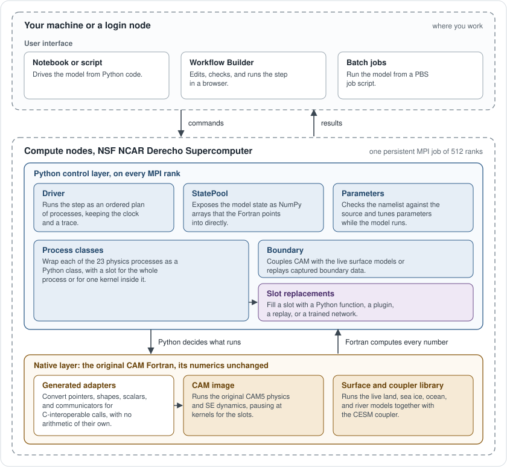
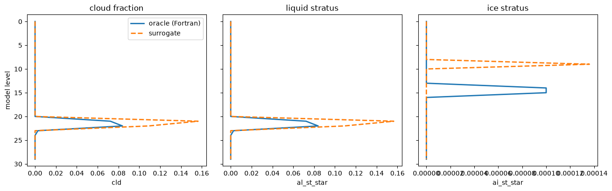
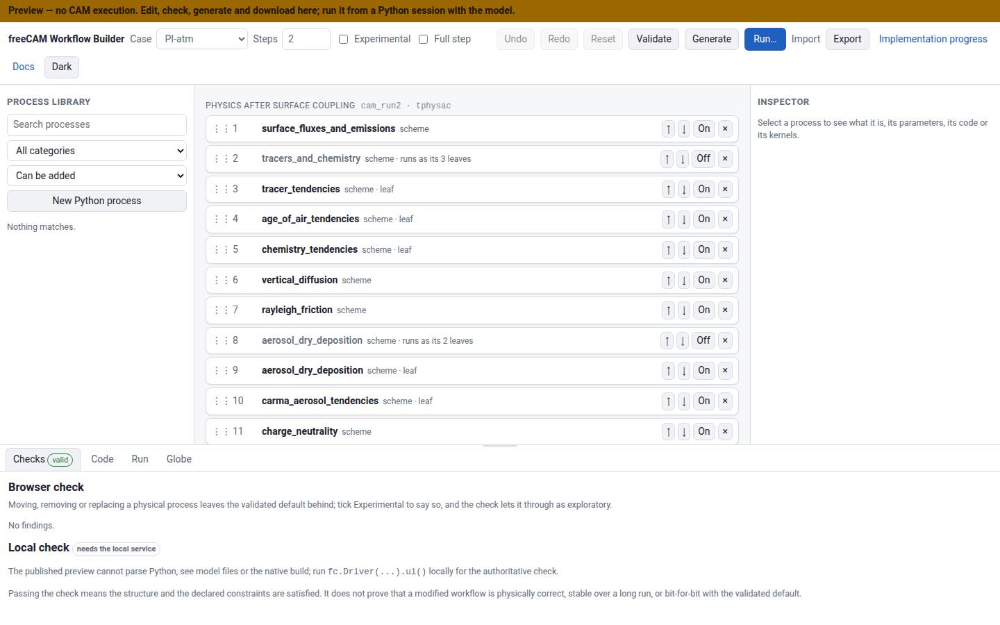

# freeCAM

freeCAM runs the CAM atmosphere of iCESM1.3.1 step by step from Python. A
notebook drives the model on NCAR Derecho: Python decides which process runs
next, reads and writes the model state as NumPy arrays, and can put Python code
or a trained network in place of a process or a single kernel. The original
Fortran computes every number, so with nothing replaced a run is bit-for-bit
the original model.

The supported configuration is the `ne16` PI-atm case: CAM5 physics, SE
dynamics, 512 MPI ranks, with the CESM land, sea-ice, ocean and river
components (CLM-SP, CICE%PRES, DOCN%DOM, RTM) and the coupler running live
beside CAM. Other rank counts run as explorations, and other compile-time
options (today `pcols`) are rebuilt by `fc.build` and checked against their own
original.



## Features

- **An editable step.** A step is an ordered list of processes: switch one
  off, move it, run it alone, or add physics written in Python, without
  rebuilding CAM.
- **Process and kernel slots.** Answer a whole process (radiation, the cloud
  macro/microphysics stage) or one kernel inside it (`compute_uwshcu_inv`,
  `mmacro_pcond`) with Python, a replay or a trained network; the
  shallow-convection network runs on the CPU or the GPU.
- **Live state.** Every CAM field is a distributed NumPy array: rank-local
  zero-copy views, global statistics, in-place edits, and Python fields
  written into CAM's own history files.
- **Schemes as functions.** Call a physics routine on one column as
  `y = f(x, p)`, with no model running, and sample it into training data.
- **Checked against the original.** The default path is bit-for-bit the
  original iCESM in 512-rank online gates; the records are under
  [validation/](validation/).
- **One persistent model.** The first live call starts one MPI job; every
  later notebook cell reuses it. `driver.ui()` opens a browser editor for the
  step, and `fc.build(pcols=32)` or `fc.Driver(ntasks=N, exploratory=True)`
  change the build or the rank count.


## Installation

freeCAM is installed from source. The Python package alone runs the unit
tests; the model also needs the pinned iCESM source, a native image built from
a configured CESM case, and the case's input data on Derecho
([docs/installation.md](docs/installation.md) has the full recipe).

```bash
git clone git@github.com:a85tract/freeCAM.git
cd freeCAM
git submodule update --init external/iCESM1.3.1_fzhu
uv sync --extra notebook --extra test
uv run python tools/prepare_pi_cam_source.py --check   # check out the pinned externals
```

Take the interpreter from the system or a conda environment rather than
letting `uv` download one (`uv sync -p /path/to/python3.13 ...`): the native
image is mapped at a fixed address, and a CPython linked at a fixed low address
can grow its heap into it.

The site is described once, in `site.env`; the allocation is the only required
entry, and the preflight reports what is still missing:

```bash
cp site.env.example site.env     # then set FREECAM_ACCOUNT
uv run python -m freecam.site
```

## Quick start

```python
import freecam as fc

# Nothing starts here: the MPI job is launched by driver.initialize().
with fc.Driver(case="PI-atm", nsteps=2) as driver:
    driver.initialize()

    temperature = driver.cam.state.T          # a distributed field
    print(temperature.stats(rank="global"))   # min, max, mean over all ranks
    print(temperature.get(rank=0).shape)      # rank 0's own array

    result = driver.run(progress=True)        # the two steps declared above
    print(driver.cam.history.latest())        # the history file CAM wrote
```

`initialize()` requests 512 MPI ranks on four Derecho nodes through PBS,
charged to `FREECAM_ACCOUNT` (`ntasks=N` takes N/128 nodes, rounded up).
Leaving the `with` block, or `driver.close()`, releases them.

## Examples

Read the running model from a notebook
([try_pi_cam.ipynb](examples/try_pi_cam.ipynb)):

```python
driver.cam.state.plot(rank=0, variables=('T', 'u', 'v', 'q', 'omega', 'pmid'))
```


Watch the state on a globe, step by step or process by process: the Workflow
Builder's *Globe* tab follows the run it starts
([docs/usage.md](docs/usage.md#in-the-workflow-builder)):

```python
ui = fc.Driver(case="PI-atm", nsteps=48).ui()
ui.url        # open it and press Run; the Globe tab shows each step as it comes
```

A run recorded to disk (`record_state=True`) opens later with
`freecam globe <run>/state`.


Inside one step the viewer shows what each process alone did to the state;
here the seven processes that change the temperature at step 24 of a
512-rank online run:

<p align="center"></p>

Put a trained network in a kernel's place and compare it with the original
Fortran on one column ([kernel_surrogate.ipynb](examples/kernel_surrogate.ipynb)):

```python
from freecam.physics.macrophysics import Macrophysics
from freecam.physics.surrogate import load_surrogate

stage = Macrophysics()
stage.kernels['mmacro_pcond'] = load_surrogate(MODEL)  # the network in the slot
answer = stage.mmacro_pcond(column)                    # one column in, one out
```



Edit the step in the browser: the Workflow Builder (`fc.Driver(...).ui()`)
adds, removes, moves and replaces processes, runs the model with them, and
generates the freeCAM code for what it shows.



## Documentation

- [Installation](docs/installation.md): the site file, the native image, the
  input data, rebuilding the CESM cases.
- [Usage](docs/usage.md): the model, state, the workflow, replacing a process
  or a kernel, parameters, the Workflow Builder.
- [Examples](examples/): start with `try_pi_cam.ipynb`; `replace_process`,
  `replace_kernel` and `kernel_surrogate` put Python or a network in CAM's
  place.
- [Validation](docs/validation.md): what bit-for-bit means here and the gates
  behind it; [performance_overhead.md](validation/performance_overhead.md):
  what the Python layer costs.
- [How the slots are built](docs/physics_kernel_decoupling.md): kernel and
  process slots, and what answering each one costs.
- The site, https://a85tract.github.io/freeCAM/: these figures and the pages
  on a trained network in the shallow-convection kernel's slot, on CPU and
  GPU.

## Development

```bash
uv run pytest -q                    # the unit suite; no MPI, no model
git diff --check
```

The unit suite checks the control layer against fakes and runs anywhere. The
scientific gates run under PBS on Derecho with 512 ranks and compare CAM's
output with the original byte for byte (`validation/jobs/submit.sh`); a change
to the numerical runtime needs one before it is merged.
[AGENTS.md](AGENTS.md) holds the repository guidelines.

## License

freeCAM is licensed under the Apache License, Version 2.0
([LICENSE.txt](LICENSE.txt)). It builds against iCESM/CESM source and other
third-party material whose terms are collected in [LICENSES/](LICENSES/) and
summarised in [NOTICE](NOTICE).
